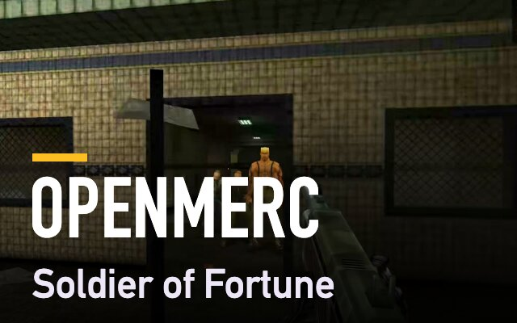
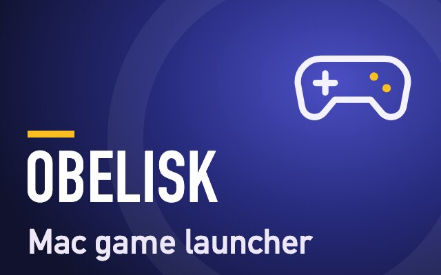
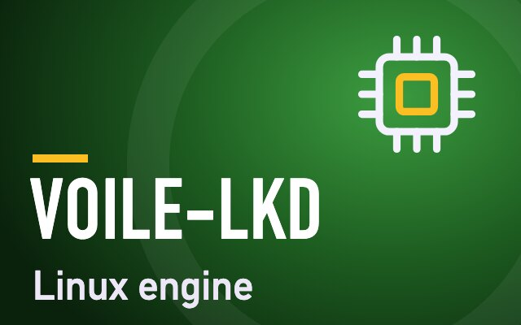
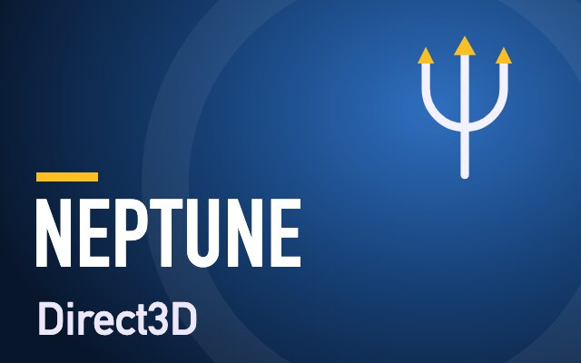
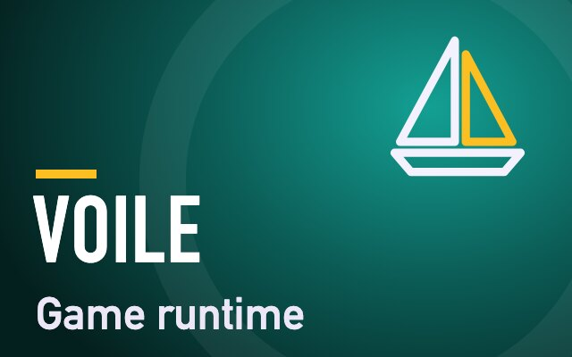
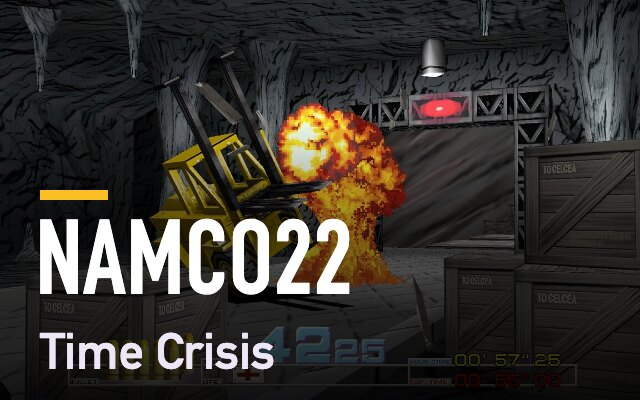

[← Back to my profile](https://github.com/gkaragioul)

# Open-source contributions

Fixes and features I've contributed to other people's projects. The status badges update live from GitHub; openMERC's developer merges by hand, so its rows link to the merged commit.

| | Contribution | Pull request | Status |
|---|---|---|---|
|  | A crouching enemy that never took a step now stands up to move | [#23](https://github.com/sidreshot/openMERC/pull/23) |  |
|  | An enemy under a low ceiling now moves instead of standing still | [#22](https://github.com/sidreshot/openMERC/pull/22) |  |
|  | The enemies riding the train now fight back | [#21](https://github.com/sidreshot/openMERC/pull/21) |  |
|  | Loading the next level no longer crashes the game | [#19](https://github.com/sidreshot/openMERC/pull/19) |  |
|  | The game finds its files when started with `-basedir` or `-cddir` | [#18](https://github.com/sidreshot/openMERC/pull/18) |  |
|  | The enemy check carries on when a level ends itself, hangs or crashes | [#17](https://github.com/sidreshot/openMERC/pull/17) |  |
|  | A check that every enemy in a level reacts to the player | [#16](https://github.com/sidreshot/openMERC/pull/16) |  |
|  | Soldier of Fortune's engine builds and runs natively on Apple silicon Macs | [#14](https://github.com/sidreshot/openMERC/pull/14) |  |
|  | Killing Floor's frame lock turns on by itself (draft, it depends on the PRs below) | [#80](https://github.com/Zagrios/Obelisk/pull/80) |  |
|  | A game can ask for a steady frame rate that suits the player's screen | [#23](https://github.com/Zagrios/voile-lkd/pull/23) |  |
|  | OpenGL frames cost less to show, with an optional frame lock | [#15](https://github.com/Zagrios/voile-wine/pull/15) |  |
|  | OpenGL frames are copied without making the game wait | [#11](https://github.com/Zagrios/neptune/pull/11) |  |
|  | 32-bit games on the Linux engine draw on the Mac's GPU through OpenGL | [#79](https://github.com/Zagrios/Obelisk/pull/79) |  |
|  | The Linux engine's Wine is built with OpenGL | [#4](https://github.com/Zagrios/Voile/pull/4) |  |
|  | The render server can run OpenGL on the Mac's GPU | [#10](https://github.com/Zagrios/neptune/pull/10) |  |
|  | OpenGL games' frames reach the window on the Linux engine | [#14](https://github.com/Zagrios/voile-wine/pull/14) |  |
|  | A test that shows the CPU information Hunt: Showdown 1896 reads is missing from the Linux engine | [#22](https://github.com/Zagrios/voile-lkd/pull/22) |  |
|  | Fixes view jumps, the pointer being pulled back after Cmd-Tab, and a fullscreen start-up crash | [#21](https://github.com/Zagrios/voile-lkd/pull/21) |  |
|  | The mouse lands in the right place when picture and window sizes differ | [#20](https://github.com/Zagrios/voile-lkd/pull/20) |  |
|  | Force Quit also ends the game | [#19](https://github.com/Zagrios/voile-lkd/pull/19) |  |
|  | Steam server lists no longer freeze the game | [#18](https://github.com/Zagrios/voile-lkd/pull/18) |  |
|  | Builds the 32-bit Windows parts that 32-bit games need on the Linux engine | [#3](https://github.com/Zagrios/Voile/pull/3) |  |
|  | 32-bit programs get display and sound on the Linux engine | [#4](https://github.com/Zagrios/voile-wine/pull/4) |  |
|  | 32-bit programs can start on the Linux engine (merged with the developer's changes) | [#5](https://github.com/Zagrios/voile-lkd/pull/5) |  |
|  | Native Mac port of Time Crisis and Time Crisis II, drawn with Metal | [#99](https://github.com/spacestate1/namco22-decompile/pull/99) |  |
|  | A Plague Tale: Innocence renders through DXMT | [#70](https://github.com/Zagrios/Obelisk/pull/70) |  |
|  | Obelisk becomes installable with `brew install --cask obelisk` | [#299745](https://github.com/Homebrew/homebrew-cask/pull/299745) |  |
|  | Windows games can play their videos, through GStreamer | [#2](https://github.com/Zagrios/Voile/pull/2) |  |
|  | Direct3D 12 games that ship the Agility SDK, such as Killing Floor 3, render on the Linux engine | [#67](https://github.com/Zagrios/Obelisk/pull/67) |  |
|  | Steam Cloud saves now sync for five games whose rules use different capitalisation | [#43](https://github.com/Zagrios/Obelisk/pull/43) |  |
|  | Steam Cloud saves now sync for games whose rules list the "all" platform, such as Quake | [#36](https://github.com/Zagrios/Obelisk/pull/36) |  |

## The projects

- **[openMERC](https://github.com/sidreshot/openMERC):** an open-source engine for Soldier of Fortune. My Mac version is on [Mac Ports](https://github.com/gkaragioul/mac-ports/blob/main/games/soldier-of-fortune.md).
- **[voile-lkd](https://github.com/Zagrios/voile-lkd):** Voile's Linux engine, for games whose anti-cheat supports Linux.
- **[Voile](https://github.com/Zagrios/Voile):** the Windows runtime Obelisk installs to run Windows games.
- **[voile-wine](https://github.com/Zagrios/voile-wine):** the version of Wine that Voile uses.
- **[neptune](https://github.com/Zagrios/neptune):** Direct3D for Voile's Linux engine, including the render server that runs on the Mac.
- **[namco22-decompile](https://github.com/spacestate1/namco22-decompile):** the arcade code of Namco's System 22 and System 23 games, translated to C. My Mac versions are on [Mac Ports](https://github.com/gkaragioul/mac-ports).
- **[Obelisk](https://github.com/Zagrios/Obelisk):** a Mac launcher that runs Windows games from Steam, Epic and GOG.
- **[Homebrew](https://brew.sh):** the package manager for macOS.

See also: [Bug reports](bug-reports.md)
